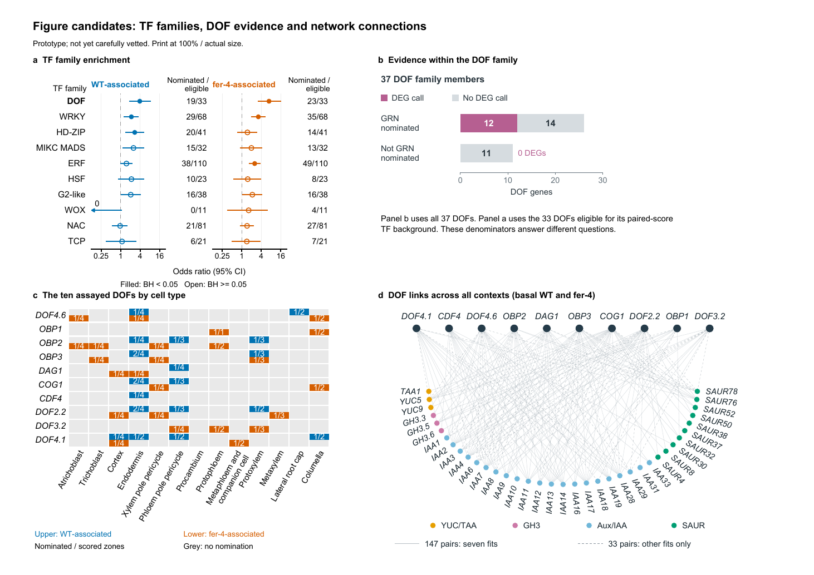

# FER-DOF Network Figure Explorer

**Prototype; not yet carefully vetted.** This package collects exploratory Figure 6 designs, saved plotting inputs, code and source checks for the FER manuscript. It is not approved for publication. The endodermal graph/score discrepancy and phloem/xylem gene-feature selection issue remain unresolved.

## Start here for Chia-Yu

1. Open [FER-DOF Network Figure Explorer, seven pages](FER_DOF_Network_Figure_Explorer.pdf), with a cover and the six-page figure/source guide linked to GitLab.
2. Read [validation status and unresolved issues](VALIDATION_STATUS.md), including the correction to the audit's developmental-context wording.
3. Use [sources, plotting code and data](SOURCES.md) and the [complete six-panel input/output/code map](revisions/2026-09-20_compact_figures/review_v7/provenance/CURRENT_INPUT_OUTPUT_CODE.csv).

The original [six-page proof with source appendix](revisions/2026-09-20_compact_figures/review_v7/review_with_sources_v7.pdf) and [three-page figure-only proof](revisions/2026-09-20_compact_figures/review_v7/review_at_print_size_v7.pdf) are retained unchanged.

| Figure | Editable SVG | Plotting R source |
|---|---|---|
| A: Top-ten TF-family enrichment | [SVG](revisions/2026-09-20_compact_figures/review_v5/quantitative/top10_aligned_forest_review_v5.svg) | [R](revisions/2026-09-20_compact_figures/review_v5/quantitative/make_review_v5_forest.R) |
| B: DOF evidence categories | [SVG](revisions/2026-09-20_compact_figures/review_v6/overlap/dof_evidence_bars.svg) | [R](revisions/2026-09-20_compact_figures/review_v6/overlap/make_dof_evidence.R) |
| C: Ten assayed DOFs by cell type | [SVG](revisions/2026-09-20_compact_figures/review_v6/quantitative/celltype_tested10_review_v6.svg) | [R](revisions/2026-09-20_compact_figures/review_v6/quantitative/make_review_v6_matrix.R) |
| D: All-context DOF/auxin target union | [SVG](revisions/2026-09-20_compact_figures/review_v7/networks/all_contexts_panel_d.svg) | [R](revisions/2026-09-20_compact_figures/review_v7/networks/make_panel_d.R) |
| Supporting vascular-context network | [SVG](revisions/2026-09-20_compact_figures/networks/vascular_overview_compact.svg) | [R](revisions/2026-09-20_compact_figures/networks/make_overviews.R) |
| Alternative overlap display: UpSet | [SVG](revisions/2026-09-20_compact_figures/upset/compact_upset.svg) | [R](revisions/2026-09-20_compact_figures/upset/make_compact_upset.R) |

PDF and PNG versions accompany every SVG. These are alternative/supporting exploratory panels; their inclusion does not select them for the manuscript.

The sharing location is the existing [FER paper repository](https://gitlab.caltech.edu/nolan_lab/feronia-cell-type-specific), branch `codex/fer-dof-figure-explorer`, folder `exploratory/fer-dof-network-figure-explorer`. See [sharing details and clone instructions](SHARING_STATUS.md). Chia-Yu already has repository access. GitLab's commit history identifies the saved revision; `master` is unchanged.

This is a bounded snapshot for review, not a self-contained portable analysis pipeline. Saved-table plotting is distinct from rebuilding GRNs. Original project-relative paths and already marked code snapshots are retained, but some scripts still depend on original paths, platform-specific graphics, software packages or excluded upstream objects. Inspect the [dependency limits](SOURCES.md#reproduction-limits) before running scripts. Raw HPC objects, full manuscript files, unrelated repository contents and task histories are excluded. Original source bytes are preserved, with code-header exceptions explicitly recorded in the [source provenance manifest](provenance/SOURCE_PROVENANCE.csv).
